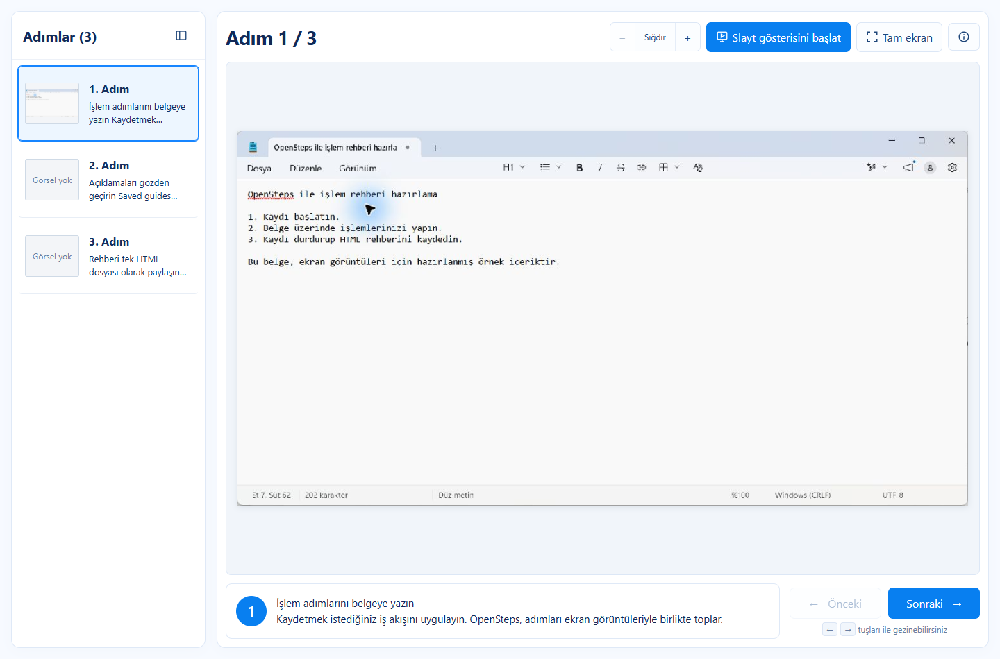
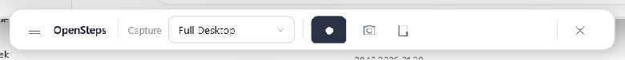
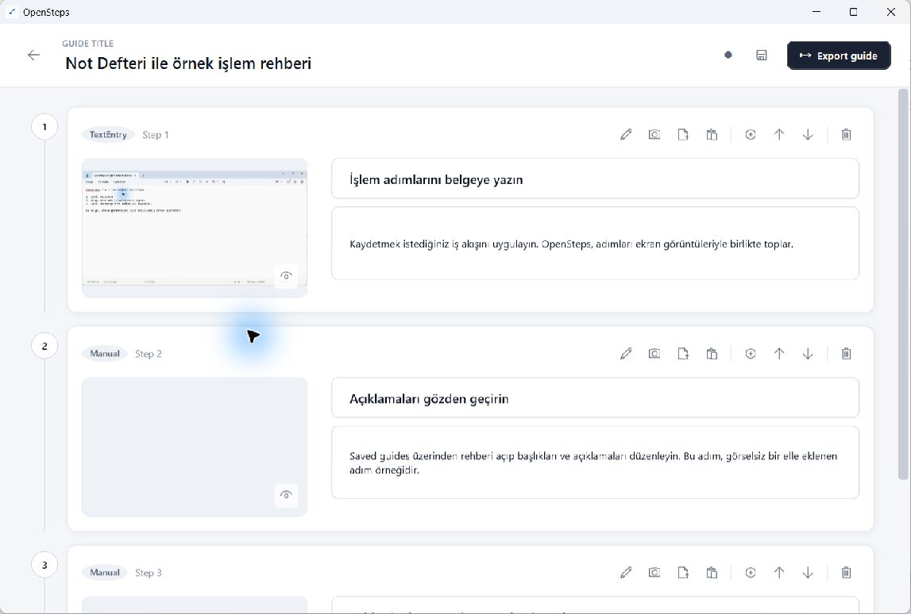

# OpenSteps

**Windows'taki işlemlerinizi kaydedin, adımları düzenleyin, tek bir HTML dosyasıyla paylaşın.**

OpenSteps, masaüstünde yaptığınız işlemleri ekran görüntüleri ve tıklama bilgileriyle adım adım rehbere dönüştüren, yerel çalışan açık kaynaklı bir Windows uygulamasıdır. Destek dokümanları, kurum içi işlem talimatları, eğitim içerikleri ve hata bildirimleri hazırlamak için geliştirilir.

Kaydı durdurduğunuzda rehberi doğrudan HTML olarak kaydedebilirsiniz. Ekran görüntüleri ve görüntüleyici aynı dosyanın içindedir; alıcı dosyayı Edge veya Chrome ile internet bağlantısı olmadan açabilir.

[**Windows için indir**](https://github.com/b061raporlama-hash/openstep/releases/latest) · [Sürüm notları](docs/releases/v0.3.0.md) · [Hata bildir](https://github.com/b061raporlama-hash/openstep/issues)

<p align="center">
  
  <br />
  <em>v0.3.0 HTML görüntüleyicisi — Not Defteri üzerinde hazırlanmış örnek rehber.</em>
</p>

> [!NOTE]
> OpenSteps geliştirme aşamasında bir Windows beta uygulamasıdır. Masaüstü arayüzü İngilizce, dışa aktarılan HTML rehberinin kontrolleri Türkçedir. Paylaşmadan önce ekran görüntülerini ve açıklamaları gözden geçirin.

## İndir ve çalıştır

1. [Son sürümün](https://github.com/b061raporlama-hash/openstep/releases/latest) **Assets** bölümünden `OpenSteps-…-win-x64.exe` dosyasını indirin.
2. İndirdiğiniz dosyayı çalıştırın. Uygulama taşınabilirdir; kurulum yapmaz ve Başlat menüsüne kısayol eklemez.
3. Alternatif olarak ZIP paketini çıkarıp içindeki `OpenSteps.App.exe` dosyasını çalıştırın.

**Gereksinim:** Windows 10 veya üzeri, x64. Yayınlanan paket .NET çalışma zamanını içerir; ayrıca .NET kurmanız gerekmez. Uygulama henüz kod imzalı olmadığı için Windows SmartScreen ilk açılışta uyarı gösterebilir. Sürümlerdeki `.sha256` dosyaları indirmelerin sağlama toplamlarını içerir.

## Nasıl kullanılır?

### 1. İş akışını kaydedin

Kayıt çubuğundaki **Capture** alanından tüm masaüstünü (**Full Desktop**) veya etkin pencereyi (**Active Window**) seçin. **Start recording** ile kaydı başlatın ve belgelemek istediğiniz işlemleri yapın.

<p align="center">
  
  <br />
  <em>Kayıt öncesi yüzen kontrol çubuğu.</em>
</p>

Kayıt sırasında alt çubuk gizlenir. Ekranın üst ortasındaki küçük yüzen kontrol, adım sayısını ve **Stop Recording** düğmesini gösterir. Sol tıklama, sağ tıklama ve çift tıklamalar; ekran görüntüsü, tıklama işareti ve uygulamanın sağladığı arayüz bilgileriyle kaydedilir. OpenSteps'in kendi arayüzüne, görev çubuğuna ve sistem tepsisine yapılan tıklamalar filtrelenir.

### 2. Kaydedin veya düzenleyin

**Stop Recording** kaydı bitirir ve doğrudan HTML kaydetme penceresini açar. Kaydetme penceresini iptal etseniz de oturum bilgisayarınızda kalır. Düzenlemek için kayıt çubuğundaki **Saved guides** düğmesinden rehberi açın.

<p align="center">
  
  <br />
  <em>v0.3.0 düzenleyicisi — örnek ekran görüntüsü ve elle eklenen adımlarla hazırlanmış rehber.</em>
</p>

Düzenleyicide şunları yapabilirsiniz:

- Rehberin ve adımların başlıklarını, adım açıklamalarını değiştirin.
- Adımları yeniden sıralayın, silin veya elle yeni adım ekleyin.
- Ekran görüntülerini kırpın ve hassas alanları gizleyin.
- Dikdörtgen, ok, yarı saydam vurgu ve sıralı sayı/harf işaretleri ekleyin.
- Yanlış yakalanan bir görüntüyü dosyadan içe aktararak veya panodan yapıştırarak değiştirin.

Görsel düzenlemeleri yeni bir PNG kopyasına işlenir; ilk yakalanan ekran görüntüsünün üzerine yazılmaz. Düzenlenmiş rehberi **Export guide** ile tekrar HTML olarak kaydedebilirsiniz.

### 3. Tek dosyayla paylaşın

Kaydettiğiniz `.html` dosyası ekran görüntülerini, açıklamaları ve görüntüleyiciyi birlikte içerir. Ayrı bir görsel klasörü veya OpenSteps kurulumu gerektirmez.

| HTML görüntüleyicisinde | Kullanım |
| --- | --- |
| Adım listesi ve küçük önizlemeler | İstediğiniz adıma doğrudan geçin; listeyi gizleyip açın. |
| Önceki / Sonraki | Düğmelerle veya klavyenin `←` / `→` tuşlarıyla ilerleyin. |
| İlk / son adım | `Home` / `End` tuşlarını kullanın. |
| Yakınlaştırma ve sığdırma | Görüntünün ayrıntılarını inceleyin, ardından ekrana sığdırın. |
| Tam ekran ve slayt gösterisi | Rehberi sunum şeklinde, adımları elle ilerleterek gösterin. |

## Yerel kayıt ve gizlilik

OpenSteps hesap gerektirmez, ekran görüntülerini sunucuya yüklemez ve telemetri içermez. Oturumlar şu klasörde tutulur:

```text
%LOCALAPPDATA%\OpenSteps\Sessions
```

Her oturumda bir `session.json` dosyası ve ekran görüntüleri bulunur. **Saved guides** üzerinden oturumları yeniden açabilir, düzenleyebilir, silebilir ve tekrar dışa aktarabilirsiniz.

Etkin pencere yakalanamazsa uygulama tüm masaüstü görüntüsüne geri dönebilir. Ekran görüntüleri ve pencere/arayüz bilgileri özel veriler içerebilir; paylaşacağınız rehberi kontrol edin ve gerektiğinde kırpma veya gizleme araçlarını kullanın.

Yazı yazma eylemi algılanır, ancak yazılan karakterler saklanmaz. `Enter`, `Tab` ve `Ctrl+S` gibi tuşlar veya kısayollar adım olarak kaydedilebilir. Yazdığınız metin yine de ekran görüntüsünde görünebilir.

## Bilinen sınırlar

- Yönetici olarak çalışan uygulamalar, OpenSteps aynı yetkiyle çalışmıyorsa yakalama veya arayüz bilgilerine erişimi engelleyebilir.
- Bazı uygulamalar yeterli arayüz bilgisi sağlamaz; otomatik adım başlıklarını düzenlemek gerekebilir.
- Etkin pencerenin sınırları, tam ekran uygulamalar ve korumalı içerik ekran yakalamayı etkileyebilir.
- Masaüstü uygulamasının mevcut dışa aktarma akışı tek dosyalık HTML üretir.

## Kaynaktan derleme

Windows üzerinde **.NET 8 SDK** gereklidir. Proje C# ve WPF ile geliştirilir.

```powershell
dotnet build OpenSteps.sln
dotnet run --project src\OpenSteps.App\OpenSteps.App.csproj
```

Testleri çalıştırmak için:

```powershell
dotnet test OpenSteps.sln
```

Depoda `OpenSteps.App` masaüstü arayüzünü, `OpenSteps.Capture` Windows yakalama katmanını, `OpenSteps.Core` oturum ve dışa aktarma işlemlerini içerir. Katkı yapmadan önce [AGENTS.md](AGENTS.md) kurallarını ve arayüz/yakalama değişiklikleri için [elle doğrulama adımlarını](docs/manual-smoke-test.md) inceleyin.

## Projenin kökeni ve lisans

Bu depo, [ebanez8/openstep](https://github.com/ebanez8/openstep) projesinden çatallanmıştır. Bu çatalla geliştirilen tek dosyalık etkileşimli HTML rehberi, Türkçe görüntüleyici kontrolleri ve yüzen kayıt kontrolü mevcut sürümün odağını oluşturur. Yukarıdaki ekran görüntüleri bu deponun v0.3.0 sürümünden alınmıştır; örnek rehber tanıtım amacıyla hazırlanmıştır.

MIT lisansı ile dağıtılır. Kaynak projenin ve katkı sahiplerinin lisans bildirimi [LICENSE](LICENSE) dosyasında korunur.
